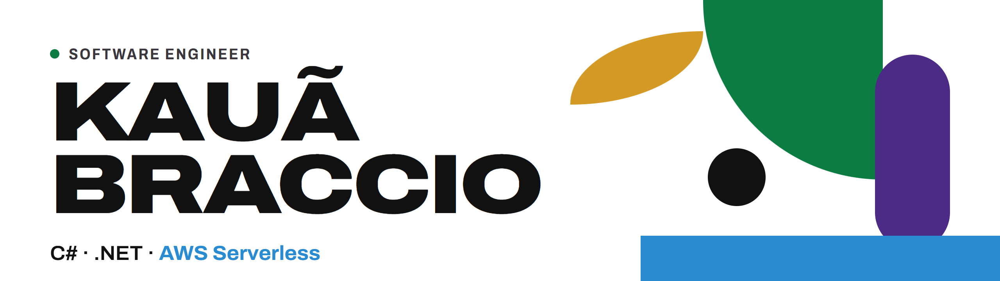

<picture>
  <source media="(prefers-color-scheme: dark)" srcset="./banner/banner-dark.png">
  
</picture>

### Hi, I'm Kauã

Software engineer at **CI&T**, working on back-end and serverless systems for one of Brazil's largest banks: system modernization and Central Bank of Brazil (BACEN) regulatory requirements.

- Serverless with **C#, .NET and AWS Lambda**, integrated with MongoDB and messaging
- Integrations between REST APIs, external registry platforms and legacy mainframe systems
- Production observability and incident investigation with CloudWatch, Datadog and Splunk
- Agentic SDLC and Specification-Driven Development (SDD) in my daily workflow
- B.Sc. in Computer Science at UniFAJ, expected 2026

### Tech I work with

  

**Architecture:** REST APIs · BFF · CQRS · MediatR · SOLID · Clean Code

### Certifications

  
  &nbsp;
  

### Portfolio

**[portfolio.kauabraccio.workers.dev](https://portfolio.kauabraccio.workers.dev/)**: experience, education and certifications, in Portuguese and English.
Built with Angular 22 and static pre-rendering; the source code is in [kauacode/portfolio](https://github.com/kauacode/portfolio).

### Contact

  
  

